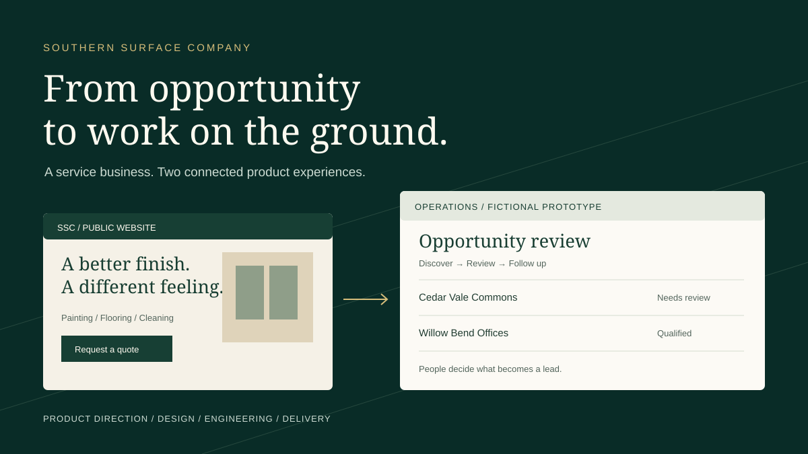

# Southern Surface Company

I built the public website and software supporting lead operations for an operating flooring, painting, and cleaning business in Middle Tennessee.

**[Read the illustrated case study](https://carsonmcrae.github.io/southern-surface/)** · **[Explore the interactive prototype](https://carsonmcrae.github.io/southern-surface/demo/)** · **[Visit the business website](https://www.southernsurfacecompany.com/)**

The illustration explains the product. The interactive prototype uses fictional records and disposable browser state.

> Interactive prototype — fictional data. No connection to Southern Surface Company's production systems.

## My role

My work spans SSC's public website and lead operations software, from interface work and architecture through implementation and testing. This case study explains the product and engineering decisions behind those workflows without publishing the private application.

## Results

**Owner-reported outcome, October 22, 2026: 150 new leads generated and 5 jobs secured with the system last month.**

These figures come from the business owner. The underlying records, exact reporting dates, and attribution of each job were not independently audited for this case study. The lead and job counts are not established as one cohort, so I do not calculate a conversion rate. No customer identities, job details, or revenue are published.

The practical outcome is that this software supports actual customer acquisition and contracting work. A discovered lead is still an opportunity to assess; it is not a customer or a completed job. Every record and count inside the public prototype is fictional and separate from these reported results.

## The problem

A small service business needs people to find its services and a repeatable way to identify potential commercial work. A list of businesses alone does not answer whether an opportunity is relevant, already known, ready to contact, or worth following up.

I connected two paths: a public website where customers can understand the services and request a quote, and a private workspace where operators review discovered opportunities and record their next actions.

## Product decisions

### Discover opportunities before adding them to the working pipeline.

Externally discovered records enter a candidate queue. A person approves or rejects them before they become verified leads. This keeps discovery from automatically endorsing source data or creating customer relationships.

### Use current public evidence with bounded collection.

The application moved beyond repeatedly processing a fixed reference list. Current public-source retrieval has limits and source checks. An empty or duplicate-only run is possible; lead quality is not measured by filling a quota.

### Make scheduled work recoverable and visible.

Scheduled discovery records its state and diagnostics, limits overlapping execution, and distinguishes degraded work from a clean result. Contact enrichment can fail while the original candidate remains available for review.

### Detect a known opportunity before doing more work on it.

The discovery path checks known candidate opportunities before enrichment. Approval then uses the existing lead workflow to resolve lead records. Repeating a run should not turn the same opportunity into several new prospects. The implementation supports this behavior; the efficiency rationale is inferred rather than a documented historical comparison.

### Treat an incoming quote request differently from a discovered prospect.

A valid request from the business website becomes an active inquiry for human follow-up. Its contact details remain unverified. First-party interest should be visible promptly without claiming that form validation proves a person's identity.

### Help a person prepare outreach and record follow-up.

The application offers manual outreach assistance, activity history, follow-up dates, and outcome tracking. People decide what to say and carry out the communication. Discovery does not send email, make calls, or secure work by itself.

[Decision evidence, rationale, and tradeoffs](docs/decisions.md)

## The public website

Visitors can explore flooring, painting, and cleaning services, review project examples and common questions, and submit a quote or contact request. The form provides required-field validation and accessible success and error feedback before a person follows up.

The reviewed implementation includes responsive navigation, a skip link, visible focus treatment, reduced-motion support, labeled form controls, and focus handling for form feedback. These are specific implementation choices, not a claim of complete accessibility certification. WCAG 2.2 AA remains the accessibility target.

Server-rendered metadata, canonical URLs, a sitemap, and structured service and organization data help describe the site to search engines. I do not claim search rankings or traffic improvements from those provisions.

## Engineering depth

**Built with:** Next.js · TypeScript · React · PostgreSQL / Prisma · Zod

The private application separates interface rendering, request validation, business rules, public-source collectors, and database access. Its test setup includes Vitest, Testing Library, and Playwright, with tests for discovery, candidate review, validation, persistence, security boundaries, and browser interaction. This showcase does not claim a newly executed production test run or a measured coverage percentage.

[Architecture and data flow](docs/architecture.md) · [Validation scope](docs/validation.md)

## A correction that mattered

An earlier discovery implementation repeatedly encountered the same fixed reference businesses. Deduplication was working, but repeating a static input did not supply fresh opportunities. The documented correction moved scheduled discovery to current public sources while keeping candidate review intact.

A later reliability decision addressed drifting run windows, stale workers, and sparse retrieval results. Those records explain why run ownership, bounded retries, and visible degraded states matter. They establish design intent and implementation history; they do not establish a measured production uptime or discovery yield.

## Status and limitations

**Operating business · Private application source · Static case-study showcase**

The business website is public. This documentation bundle accompanies the illustrated case study and fictional interactive prototype in my portfolio. The standalone repository contains the explanations and original artwork; the executable prototype is maintained in the portfolio repository.

Human verification, outreach, estimates, scheduling, and service delivery still require judgment and action. Source availability and permission affect discovery. More complete attribution would require agreed reporting dates and privacy-safe evidence linking opportunities to jobs; the published owner report does not provide that analysis.

The public prototype is a simplified explanation of supported behavior. It contains no customer records, production credentials, privileged links, or private backend modules. It cannot discover real leads, contact anyone, or change business records.

[Security and privacy boundary](SECURITY.md) · [Publication and maintenance](PUBLISHING.md)

## More work

[Carson McRae](https://carsonmcrae.github.io/) · [GitHub profile](https://github.com/carsonmcrae) · [PicPledge](https://carsonmcrae.github.io/picpledge/) · [Recalen](https://carsonmcrae.github.io/recalen/) · [TTSNative](https://carsonmcrae.github.io/ttsnative-case-study/)
