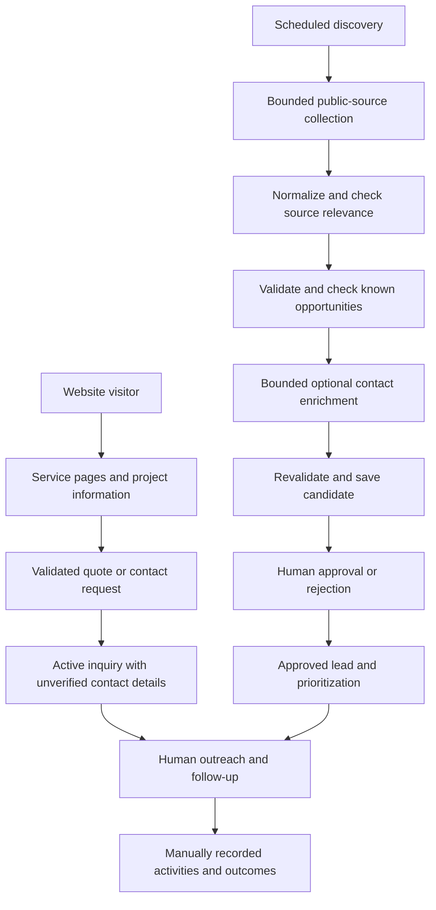
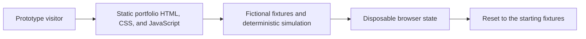

# Architecture

This is an abstract description of the private application's reviewed design. It omits operational URLs, source query contracts, authentication configuration, deployment settings, and database details.

## Two paths into human operations

Text equivalent: a website visitor submits a request that becomes an active but unverified inquiry. Scheduled discovery follows a separate path through bounded collection, normalization, relevance checks, deduplication, optional enrichment, candidate persistence, and human review. Approved candidates and incoming inquiries support human follow-up. People record activities and business outcomes.

Source collectors apply source-specific scope, location, and date checks where relevant. Qualification is not one universal step after saving: it occurs at several boundaries. Candidate persistence rechecks the record, and approval is a separate human decision.

## Component responsibilities

| Component | Responsibility |
| --- | --- |
| Public Next.js / React website | Service information, quote request interface, page metadata, and responsive navigation |
| Private operator interface | Candidate review, lead details, activity history, follow-up, and operational status |
| Request boundary and shared validation | Validate input, authorize protected actions, and return appropriate feedback |
| Business services | Candidate handling, opportunity identity, prioritization, inquiry intake, and workflow rules |
| Public-source collectors | Retrieve limited public records and normalize source evidence |
| Repositories with Prisma / PostgreSQL | Persist business records and discovery state |
| Scheduler and run coordination | Bound execution, maintain run ownership, record diagnostics, and support recovery |

The scheduled process coordinates its run state around the discovery steps. Source checkpoints and completion metadata support diagnosis and retry behavior; they do not make a public-source result inherently accurate.

## The public prototype has a different architecture

Text equivalent: a visitor loads static portfolio assets. Local JavaScript advances fictional fixtures through a deterministic simulation and updates disposable state. Reset restores the starting state.

The prototype has no application server, production API integration, database connection, authentication integration, real scheduler, source retrieval, or outreach integration. Its discovery button advances an explanation. External links navigate to the public website or other public portfolio pages.
